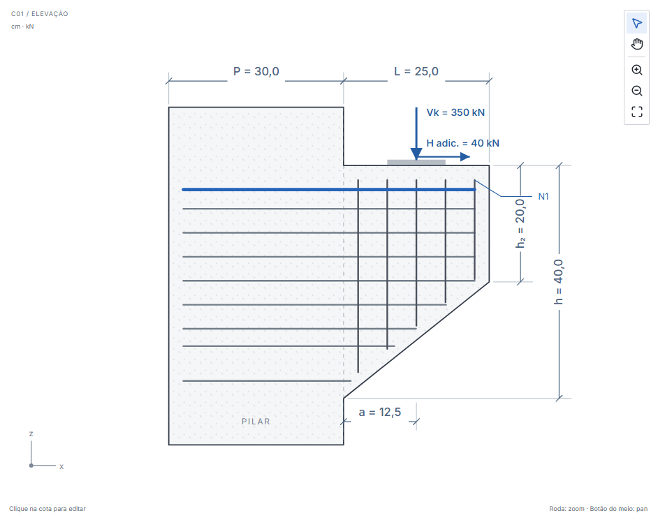
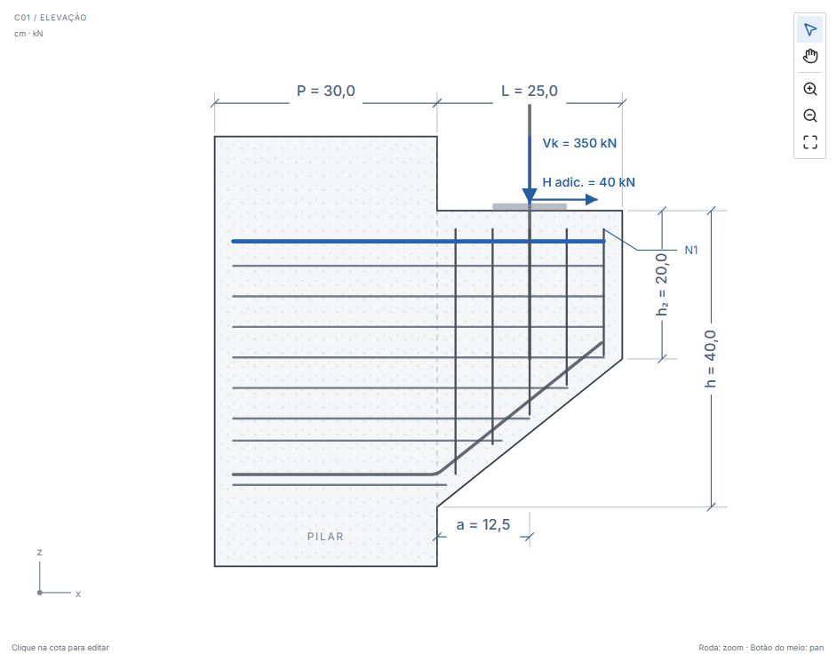
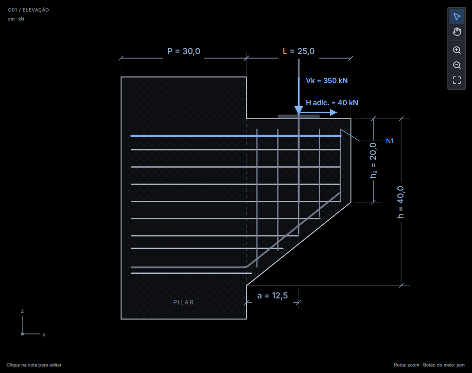
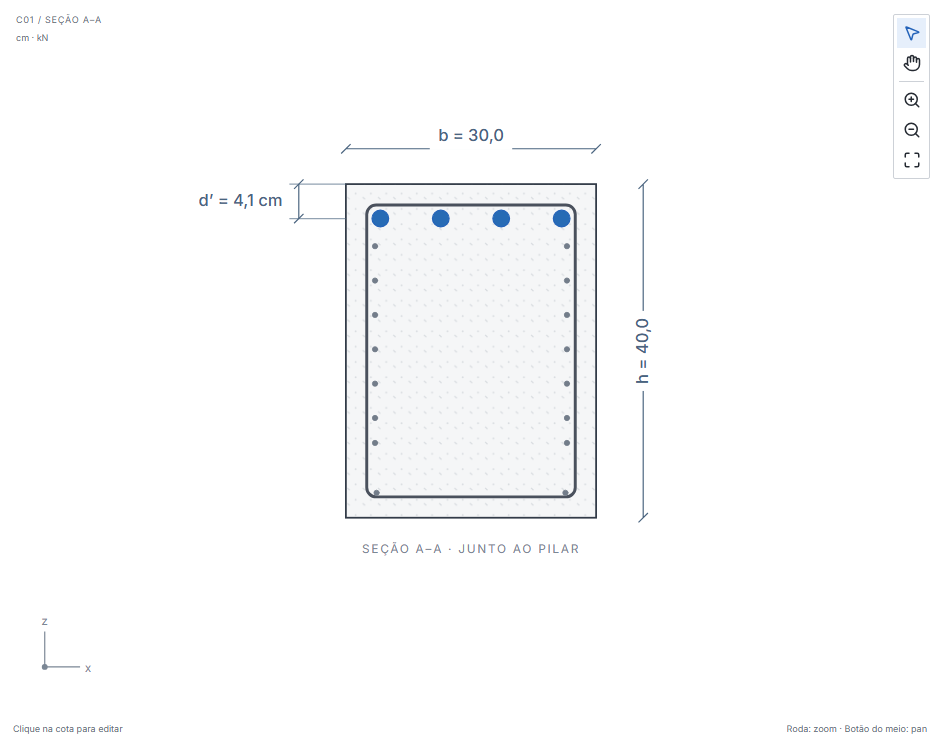
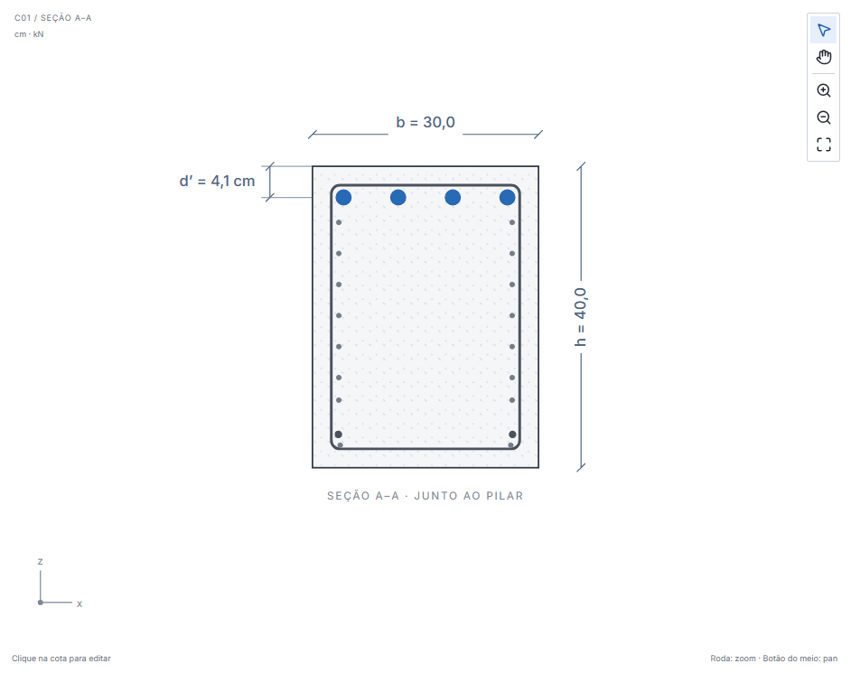
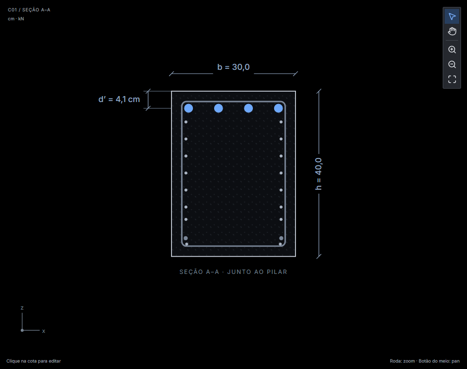

# Validação: famílias de barras nas vistas de modelagem (#36)

## Mudança

`src/detailing/projection.ts` projeta nas vistas de modelagem as barras geradas pelo detalhamento. A elevação passa a mostrar porta-estribos, pinos e a barra transversal soldada (vista de topo). A seção A–A mostra o porta-estribos nos dois cantos inferiores do estribo, apenas quando a barra cruza o plano de corte. N1, N2, N3, d’ e o armado como viga não mudaram. Sem alteração de cálculo, quantitativos ou arquivos de projeto.

## Capturas

Mesmo projeto (exemplo C01 com porta-estribos inferior e 2 pinos). Capturas reais de Chromium.

Elevação, antes e depois (tema claro):

Elevação, depois (tema escuro):

Seção A–A, antes e depois (tema claro):

Seção A–A, depois (tema escuro):

## Limites

- A barra transversal soldada só aparece com ancoragem frontal soldada; não há captura dela.
- O desenho de fabricação da aba Detalhamento não mostra o porta-estribos na seção; não foi alterado.
- Sem validação nativa Tauri. Testes aprovados não constituem certificação normativa nem liberação de projeto executivo.
