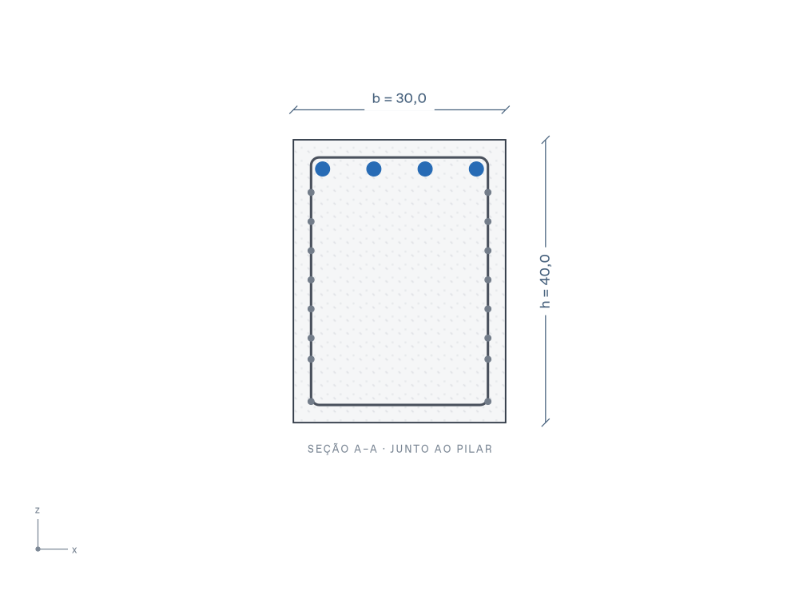
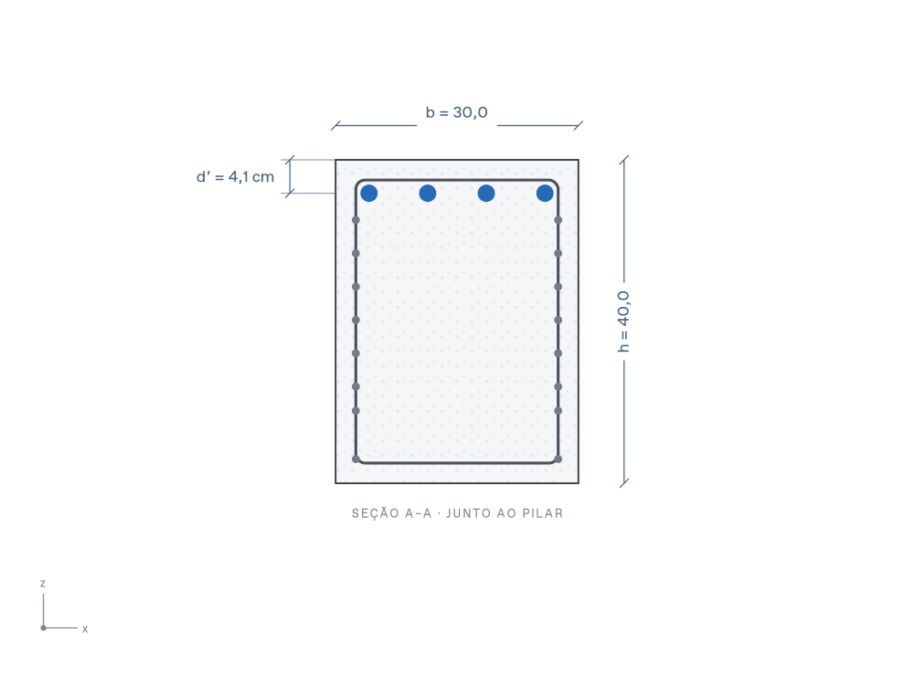
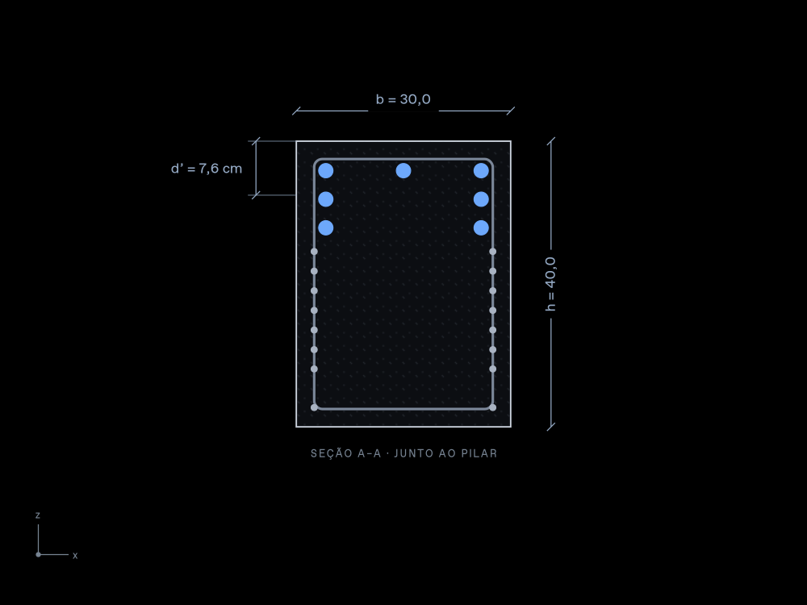

# Cota d’ na seção A–A — issue #20

## Integração com master em 12/11/2026

O PR #24 foi integrado localmente sobre `fa8c890`, preservando os três commits de Ricardo Corsini. O único conflito de conteúdo era no histórico; as duas contribuições foram mantidas. O componente atual conserva o recorte de concreto e o modo de detalhamento como viga.

Validação em Windows, Node.js 24.11.1 e Chromium 145 (Playwright 1.58.2): `npm run format:check`, `npm run check` (280 testes), `npm run build` e os seis testes de `tests/e2e/editor.spec.ts` aprovados. Os três testes de d’ executaram os critérios CA1–CA5 no navegador, incluindo geometria, camadas desiguais, edição, temas, zoom/pan, projeto salvo e cálculo auditável. O build mantém os avisos existentes sobre tamanho dos pacotes. Não houve teste nativo Tauri.

O relato abaixo documenta a implementação original de 11/11 e suas limitações naquele ambiente; os testes interativos antes pendentes foram executados com sucesso nesta integração.

Conferência em 11/11/2026, a partir de `master@2720f58e0d0a6fdf28cae992bbe6f0d2acc01a42`, mesma base registrada nas issues #19 e #20. A #19 é a issue-mãe; este trabalho atende à primeira subtarefa (#20). O posicionamento de N2 (#21) continua pendente.

## Implementado

A seção A–A da modelagem exibe d’ à esquerda, do topo ao centroide existente de todas as barras, usando `tieLayout(p).dPrime`. O texto horizontal externo mostra centímetros com uma casa decimal e vírgula. As linhas auxiliares identificam os extremos. A cota não é um botão, não recebe foco de edição e não altera entradas; b e h continuam editáveis. A apresentação acompanha Mostrar cotas e o transform compartilhado de zoom/pan, independentemente de Mostrar armaduras.

## Validação local

Ambiente: Node.js 24.22.1, dependências instaladas com `npm ci`.

| Verificação                                           | Resultado                                                                                                               |
| ----------------------------------------------------- | ----------------------------------------------------------------------------------------------------------------------- |
| `npm run format:check`                                | Aprovado na base e após a implementação.                                                                                |
| `npm run check`                                       | TypeScript e 167 testes unitários aprovados na base e após a implementação.                                             |
| `npm run build`                                       | Aprovado; avisos de dependências e empacotamento, sem erro.                                                             |
| `npx playwright test --list tests/e2e/editor.spec.ts` | Seis testes reconhecidos, incluindo as três regressões adicionadas.                                                     |
| Resultados completos do motor                         | Idênticos antes/depois nos três casos abaixo, comparados com a mesma entrada. A renderização não modificou as entradas. |
| SVG da elevação                                       | Idêntico antes/depois, incluindo cotas, cargas, grade e armaduras.                                                      |
| SVG com Mostrar cotas desligado                       | Idêntico antes/depois na elevação e seção, com armaduras ligadas/desligadas.                                            |

Os módulos anteriores foram compilados separadamente antes da edição do componente; não se compararam duas chamadas à mesma versão do componente.

| Camadas | Barras por camada | d’ existente (mm) | Texto esperado |
| ------- | ----------------- | ----------------: | -------------- |
| 1       | 4                 |              41,3 | d’ = 4,1 cm    |
| 2       | 3 + 2             |              57,3 | d’ = 5,7 cm    |
| 3       | 3 + 2 + 2         | 75,58571428571429 | d’ = 7,6 cm    |

Os testes de interface novos verificam o valor contra `tieLayout` e o extremo inferior contra a média dos eixos de todos os círculos N1 efetivamente desenhados. Cobrem mudanças de cobrimento, bitolas N1/N3, quantidade, camadas com contagens desiguais e afastamento adicional; consulta sem editor; seleção N2; edição b/h; Mostrar cotas e armaduras; temas claro/escuro; zoom/pan; e comparação integral de projetos salvos e cálculos auditáveis, excluindo somente o timestamp de geração destes últimos.

## Imagens e limites da conferência

As imagens abaixo são renderizações estáticas do SVG produzido pelo componente React, com as cores da folha de estilos do aplicativo. Foram inspecionadas nos dois temas. Não são capturas de uma sessão interativa do navegador.

Antes, uma camada, base `2720f58`:

Depois, uma camada, tema claro:

Depois, três camadas com 3 + 2 + 2 barras, tema escuro. O extremo inferior termina no centroide entre camadas:

`npx playwright install chromium` falhou localmente porque o download retornou um ZIP truncado. A alternativa com o Chromium instalado também foi bloqueada antes de abrir a página: `socket() failed: Operation not permitted`. Assim, os testes interativos não foram executados localmente. A CI usa o ambiente Playwright já adotado no projeto; os novos testes anexam imagens nos temas claro/escuro, e o workflow preserva esses anexos por sete dias também quando aprovado.

O resultado da CI deve ser conferido no PR. Até sua conclusão, a interação de mouse/teclado, a geometria no DOM real e os critérios CA1–CA5 de ponta a ponta permanecem aguardando essa execução. Não houve teste nativo Tauri; não há alteração nativa nesta entrega.

Motor, fórmulas, quantitativos, arquivos, exportações, elevação, 3D e desenhos de fabricação não foram alterados. Testes aprovados não representam certificação normativa ou liberação para execução.
