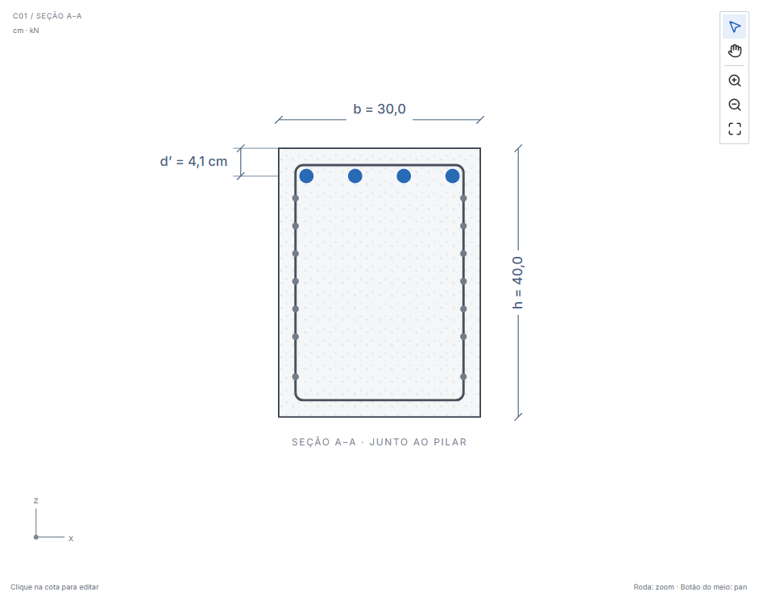
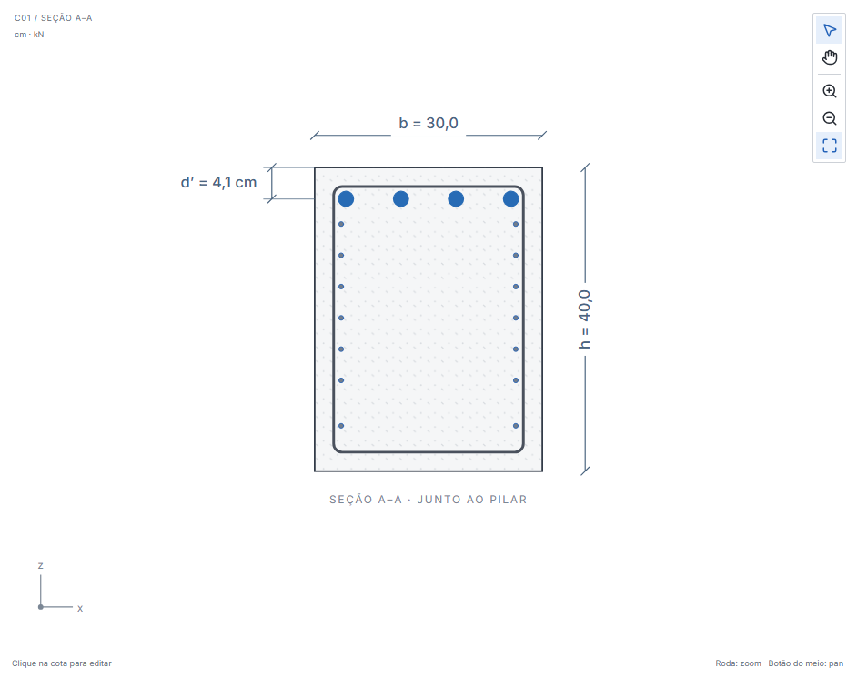
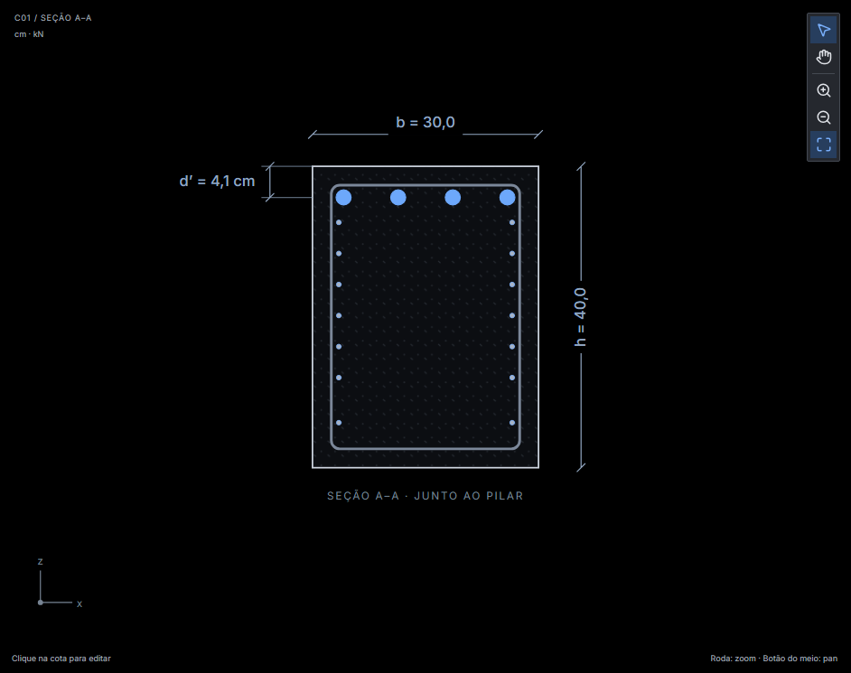

# Seção A–A integrada — issues #19 e #21

Base: master `fa8c890`, com os commits originais do PR #24 preservados no merge `314d5f4` (PR #37). Conferência em 12/11/2026, Windows, Node.js 24.11.1 e Chromium 145 / Playwright 1.58.2.

## Implementação

A alteração de N2 limita-se ao ramo `section` de `src/components/Drawing.tsx`. O afastamento lateral parte de cobrimento + diâmetro N3 + metade do diâmetro N2, como na referência de fabricação. O raio é metade da bitola N2 na escala do desenho. A representação considera o contorno visível de N3, seus cantos arredondados e os dois traços, com uma folga gráfica que acompanha o transform de zoom/pan. Essa folga não é regra de espaçamento físico ou normativa.

Todos os níveis superiores e inferiores usam o mesmo posicionamento simétrico. Alturas, contagem, seleção, N1, N3, d’, motor, quantitativos, persistência, detalhamento, exportações, elevação e 3D permanecem preservados. Não se criam regras para fazer arranjos fisicamente incompatíveis caberem; esses arranjos continuam sujeitos às verificações existentes.

## Regressões

Os testes novos em `tests/e2e/editor.spec.ts` verificam:

- Círculos completos de ambas as faces dentro de N3, incluindo raios, traços e distância ao contorno arredondado, não apenas coordenadas dos centros.
- Seções 300 × 400, 500 × 600 e 800 × 2000 mm, com cobrimentos 25/40/35 mm, N2 de 6,3/16/5 mm e N3 de 6,3/10/5 mm. O terceiro caso usa comprimento de 3000 mm para reduzir a escala e exercitar o traço e os cantos.
- Uma e três camadas N1 com contagens desiguais, costura superior e inferior, contagem e alturas derivadas dos layouts existentes, sem deslocamento vertical.
- Alterações de largura, cobrimento e bitolas N2/N3 pela interface; d’ integrado, seleção, Mostrar armaduras, temas claro/escuro e zoom/pan.
- Igualdade do projeto salvo e das entradas esperadas. As regressões de d’ preservam a comparação integral do cálculo auditável antes/depois da navegação.

Os três testes geométricos falharam no componente anterior pela sobreposição dos contornos. A avaliação adicional do contorno arredondado encontrou uma interferência de 0,022 unidade SVG na seção reduzida; o posicionamento passou a considerar a curva também. O componente anterior foi novamente executado com as mesmas entradas da captura final para confirmar a falha e gerar a imagem “antes”.

As configurações de regressão da costura inferior foram escolhidas com espaço vertical para as bitolas informadas. Alterar níveis ou inventar uma regra de espaçamento para arranjos incompatíveis está fora do escopo.

## Resultado da validação

- `npm run format:check`: aprovado.
- `npm run check`: TypeScript e 280 testes unitários aprovados.
- `npm run build`: aprovado, com avisos existentes de tamanho de pacotes.
- `npx playwright install chromium`: navegador instalado com sucesso.
- `npm run test:e2e`: 84 testes aprovados, incluindo dez de editor (três de d’ e quatro de N2).
- Revisão independente: sem defeitos acionáveis; verificação numérica do contorno arredondado passou em 296.560 casos geometricamente viáveis.
- Diff de `src/domain`, `src/detailing`, `src/visualization` e `src/lib` contra master: vazio.

## Capturas

Mesmas entradas, seção 300 × 400 mm com uma costura inferior. Capturas reais de Chromium.

Antes:

Depois, tema claro:

Depois, tema escuro:

## Limites

Não houve validação nativa Tauri; a mudança é de apresentação web. Os avisos existentes do build sobre tamanho dos pacotes permanecem. Testes aprovados não constituem certificação normativa nem liberação de projeto executivo.
